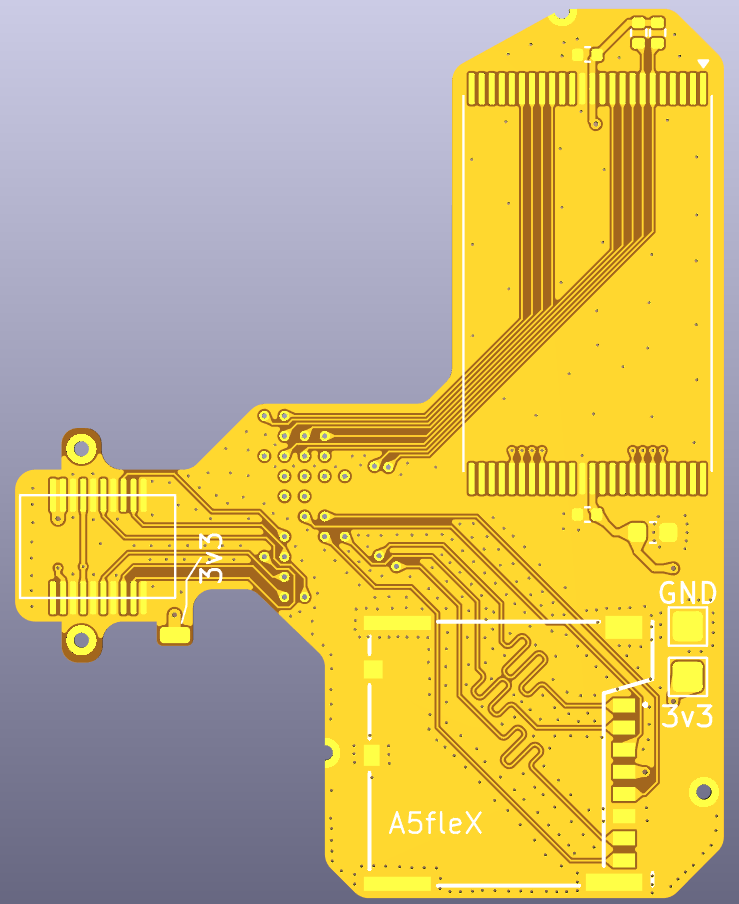
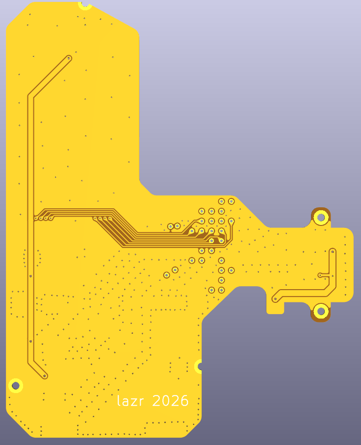
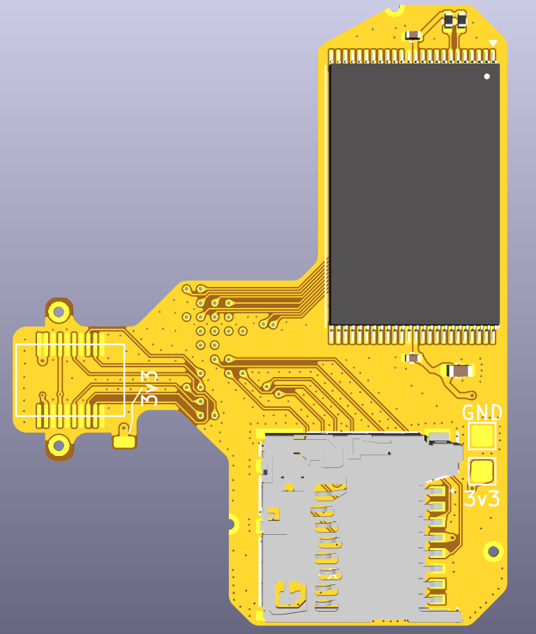

## A5fleX
A5fleX is a NAND/eMMC (in the form of a microSD card)/WiFi relocation FPC for Wii U motherboards that house the A5X processor.

For motherboards with the B1X processor, use the [cafeFlex](https://github.com/mackieks/cafeFlex/).

**A5fleX has not been tested**, it probably works but I have not confirmed so (yet). Designing hardware is free, testing it not so much..

### Credits
Lazr - Layout / routing
YveltalGriffin - cafeFlex, the schematic of which was directly used here.
